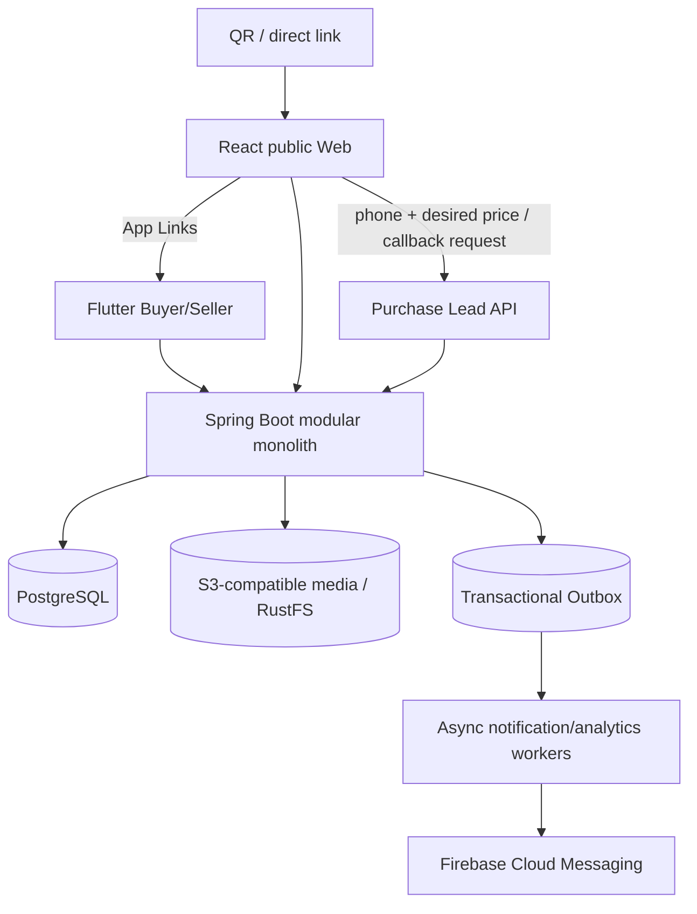
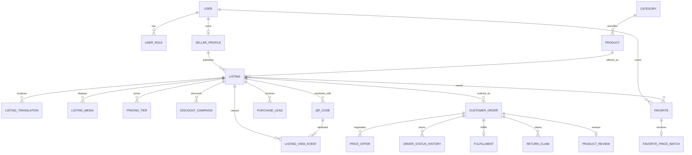

# QRM — архитектура и доменная модель (R0 draft)

**Статус:** proposed architecture; не код и не утверждённая SQL-схема. Источник функциональных требований — [REQUIREMENTS.md](REQUIREMENTS.md).

## 1. Целевая схема



Backend: Java 17, поддерживаемая версия Spring Boot 3, Spring Security, Data JPA, Liquibase, PostgreSQL, S3 API, Micrometer/OpenTelemetry, REST/OpenAPI. Frontend: React + TypeScript public storefront; Flutter Android/iOS. Старт — модульный монолит: транзакционная согласованность заказов и предложений важнее разбиения на процессы.

## 2. Bounded contexts и ответственность

| Модуль | Владеет | Не должен делать |
|---|---|---|
| identity | Account, Role, OTP, credentials | управлять Listing |
| seller | SellerProfile, публичный slug, logoMediaId | копировать фото в каждый Listing |
| catalog | Category, Product, unit definitions | назначать цену продавца |
| listing | Listing, Translation, visibility, media refs | принимать оплату |
| media | Upload, validation, thumbnails, S3 keys | хранить business metadata заказа |
| pricing | PricingTier, effective-price query, DiscountCampaign | менять подтверждённый заказ |
| qr | QR code, source attribution, stable redirect | хранить цену в QR |
| lead | PurchaseLead, callback consent, lead status, anti-spam | превращать Web callback в заказ автоматически |
| negotiation | PriceNegotiation, PriceOffer, 5 rounds | менять Listing price |
| order | CustomerOrder, immutable price snapshot, status | делать перевод денег |
| fulfillment | Delivery, ServiceCompletion, DigitalProvision, ReturnClaim | использовать одну механику доставки для всех типов |
| favorite | Favorite, FavoritePriceWatch | позволять Web UI сохранять избранное |
| rating | ProductReview, SellerReview, moderation state | оценивать качество до получения |
| analytics | ViewEvent, QRVisit, daily aggregates | блокировать read path |
| notification | preferences, device, dedup, deliveries | менять состояние заказа по факту push |

Прямое использование таблиц чужого модуля из application/domain layer запрещено. Коммуникация — публичные application contracts, доменные события или согласованный read model. Проверять ArchUnit.

## 3. Логическая ER-диаграмма



Отдельные сущности также: `MediaObject`, `ListingVideo`, `NotificationPreference`, `PushDevice`, `NotificationDelivery`, `OutboxEvent`, `AuditEvent`, `ReturnReason`, `SellerReview`, `DailyAnalyticsAggregate`, `MeasurementUnit`. Непосредственное участие переговоров в заказе уточняется на R0: согласование может начинаться до создания Order; нельзя требовать CustomerOrder для ещё не подтверждённой цены. Итоговая ER должна отделять NegotiationSession от CustomerOrder и связывать accepted offer с новым заказом.

## 4. API surface (проектные маршруты)

```http
POST   /api/v1/auth/otp/request
POST   /api/v1/auth/otp/verify
GET    /api/v1/sellers/{slug}
GET    /api/v1/sellers/{slug}/listings
PATCH  /api/v1/me/seller-profile
PUT    /api/v1/me/seller-profile/logo
GET    /api/v1/categories
POST   /api/v1/listings
PATCH  /api/v1/listings/{id}
POST   /api/v1/listings/{id}/publish
GET    /api/v1/public/listings/{publicId}
POST   /api/v1/listings/{id}/discounts
POST   /api/v1/listings/{id}/qr-codes
GET    /api/v1/listings/{id}/qr-codes
POST   /api/v1/public/leads
GET    /api/v1/me/seller/leads
POST   /api/v1/negotiations
POST   /api/v1/negotiations/{id}/offers
POST   /api/v1/orders
GET    /api/v1/me/orders
POST   /api/v1/orders/{id}/transitions
POST   /api/v1/orders/{id}/claims
POST   /api/v1/me/favorites/{listingId}
DELETE /api/v1/me/favorites/{listingId}
GET    /api/v1/me/favorites
PUT    /api/v1/me/favorites/{listingId}/price-watch
POST   /api/v1/analytics/events
GET    /api/v1/listings/{id}/analytics
POST   /api/v1/me/push-devices
PUT    /api/v1/me/notification-preferences
POST   /api/v1/orders/{id}/reviews
```

Для PUT logo нужно уточнить multipart vs предварительно подписанный media upload. Endpoints — направления проектирования, не готовый OpenAPI контракт.

## 5. События и транзакции

- `ListingPublished`, `ListingArchived`, `EffectivePriceChanged`, `DiscountActivated`
- `PurchaseLeadCreated`, `PriceOfferSubmitted`, `NegotiationAccepted`
- `OrderCreated`, `OrderStatusChanged`, `OrderDelivered`
- `FavoriteAdded`, `ReviewCreated`

Outbox записывается в транзакции вместе с модифицируемым агрегатом. Worker повторяет обработку; consumer idempotent на `eventId`. Цена считается в синхронной транзакции на backend; push и аналитика отдельно. Для запланированной акции событие цены создаётся надёжным планировщиком, включая восстановление после downtime (не полагаться только на in-memory timer).

## 6. Инварианты хранения

- `User.nickname` unique (normalized), `SellerProfile.publicSlug` unique.
- `Favorite(userId,listingId)` unique.
- `ListingTranslation(listingId,locale)` unique.
- PricingTier range non-overlap — transactional validation + DB guard по согласованной реализации.
- Для discount overlap — аналогично по эффективной области и времени.
- `Order.idempotencyKey` unique в scope пользователя/операции.
- `PurchaseLead.convertedOrderId` не допускает двойную конвертацию.
- Negotiation offers append-only history, max 5 rounds under row lock.
- Подтверждённые order price snapshots immutable.
- Public read не возвращает private phone/address.
- Decimal money and quantity scale documented; timestamps UTC; per-seller timezone recorded.

## 7. Основные trade-offs

**Web vs Flutter:** Web обеспечивает просмотр и создание lead; избранное и полноценные заказы — Flutter. Не считать отключённое Web-сердце границей серверной безопасности.  
**Digital/service fulfillment:** отдельные субмодели исполнения вместо ложных статусов `IN_TRANSIT` для digital.  
**Analytics:** старт с PostgreSQL + aggregates; партиционирование сырых событий вводить по фактическому объёму.  
**Media:** S3-совместимый API позволяет поменять провайдера; видео YouTube не копируется на сервер.  
**KZT:** в MVP только KZT, но код валюты явный в price/order; не смешивать валюты без правил FX.  
**Legal:** QRM — технический посредник, но этот термин сам по себе не устанавливает юридический статус; юридические документы проверяются до запуска.

## 8. Репозиторий (предлагаемая структура)

```text
backend/
  modules/{identity,seller,catalog,listing,media,pricing,qr,lead,negotiation,order,fulfillment,favorite,rating,analytics,notification}/
  infrastructure/
web/react-public/
mobile/flutter-app/
contracts/openapi/
docs/{REQUIREMENTS,ARCHITECTURE,DECISIONS,SCENARIOS,ROADMAP}.md
deployment/
```

## 9. Необходимые уточнения R0

1. Разделить NegotiationSession и Order: согласование до финального заказа.
2. Строгая матрица переходов по типам PHYSICAL/SERVICE/DIGITAL и роли.
3. Согласованная семантика 5 раундов (пара обменов или 5 сообщений-counter).
4. Часовой пояс, границы окон акций, price-tracking compare policy.
5. Минимальные требования к жалобам и защите продавцов от фальшивых leads.
6. Срок хранения контактных данных, legal privacy и пользовательских согласий.

## 10. DEC-17 и DEC-18: разграничение конверсии и отмены

**Web PurchaseLead:** телефон/цена/количество/согласие на обратный звонок → NEW/VIEWED → продавец связывается вне системы → CONTACTED/DECLINED/EXPIRED; WITHDRAWN по инициативе заявителя. Никакого автоматического создания Order или обязательного OTP в Web.

**Flutter PriceNegotiation:** offer → accept/counter/reject → AGREED → явное создание CustomerOrder, связанного с согласованной ценой/количеством/сторонами; один Order на согласованное предложение. Блокировка дублей и гонок в PostgreSQL.

**Buyer cancellation:** для незавершённого Lead/offer — WITHDRAWN; для ещё неподтверждённого Order — CANCELLED_BY_BUYER; после подтверждения — CANCELLATION_REQUESTED с типоспецифичной обработкой и сохранением законных прав покупателя. Все переходы аудитируются, продавец уведомляется.
