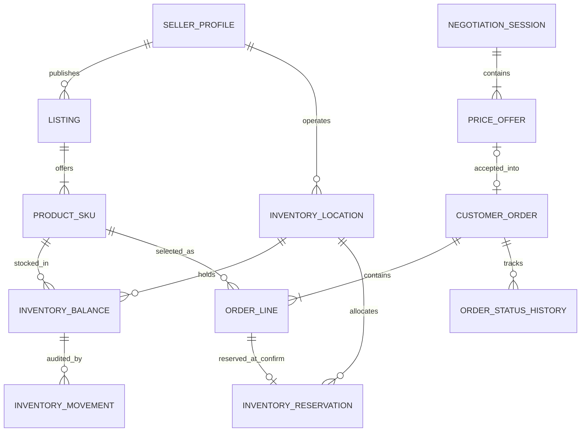

# DEC-ENTITY-2026-11-12 — SKU, multi-line orders, locations and reservations

**Status:** product owner APPROVED for four choices; ancillary MVP scope assumptions explicitly PROPOSED for independent S2 review. No executable code or tests yet.

## Approved

1. One Listing contains **multiple ProductSku variants** (1..N); SKU belongs to one Listing and inherits its seller.
2. A CustomerOrder contains **multiple OrderLine** (1..N), each with immutable item, quantity, currency, price, unit and pricing-version snapshot.
3. The seller chooses whether inventory is tracked, represented by `ProductSku.stockTrackingMode = TRACKED | UNTRACKED`. Never show authoritative stock quantity for UNTRACKED.
4. **Stock reservation starts only when the seller confirms an order**. Buyer-created PLACED orders do not reserve inventory, and confirmation may fail if stock disappears.
5. Include **InventoryLocation now**, with seller ownership, region and structured address; seller may own multiple locations.

## Proposed first implementation boundaries (S2 review required)

- Each CustomerOrder belongs to exactly **one seller** and may include SKU from multiple Listings of that seller. A mixed-seller cart must be split into independent orders or rejected; never silently merge sellers in one transaction.
- Each TRACKED order line is allocated to **one InventoryLocation** on confirmation. Splitting a single line across locations remains a future feature.
- Seller confirmation is **all-or-nothing**. Every TRACKED line must reserve successfully before `PLACED -> CONFIRMED`; failure returns conflict with no reservations or outbox confirmation event. UNTRACKED lines have no inventory reservation.
- For physical goods, `InventoryBalance` is a stock source of truth; nonphysical service capacity remains a separate future policy.
- An accepted `PriceOffer` may be tied to an individual line or basket: **offer scope and negotiated multi-line pricing are OPEN for S2**. No blind propagation of a single negotiated unit price across every line.

## Core entity contracts

| Entity | Key fields / constraints |
| --- | --- |
| SellerProfile | id, ownerUserId |
| Listing | id, sellerId, productId, publicationStatus |
| ProductSku | id, listingId, sellerSkuCode, variantAttributes, stockTrackingMode, active, version; UNIQUE(sellerId,sellerSkuCode) via explicit persisted sellerId or equivalent enforced constraint |
| InventoryLocation | id, sellerId, code, name, regionCode, regionName, city, district?, street, building, unit?, postalCode?, addressLine?, latitude?, longitude?, timezone?, active, version, createdAt, updatedAt; UNIQUE(sellerId,code) |
| InventoryBalance | id, locationId, skuId, onHand, reserved, version; UNIQUE(locationId,skuId), CHECK(onHand>=0 AND reserved>=0 AND reserved<=onHand); available = onHand-reserved |
| CustomerOrder | id, sellerId, buyerId, status, pricingSnapshotTotal, currency, version, idempotencyScope, createdAt |
| OrderLine | id, orderId, listingId, skuId, sku/variant/name/unit snapshot, quantity, unitPrice, lineTotal, currency, priceVersion |
| InventoryReservation | id, orderLineId, locationId, skuId, quantity, status ACTIVE/CONSUMED/RELEASED, createdAt, releasedAt?, consumedAt?; unique active allocation per line in R1 |
| InventoryMovement | id, locationId, skuId, orderLineId?, eventKind, onHandDelta, reservedDelta, actorId?, correlationId, createdAt; append-only and idempotent |
| OrderStatusHistory | orderId, fromStatus, toStatus, actorId, eventTime, version |
| OutboxEvent | eventId, aggregateId, eventType, payload, createdAt, publish state |

**Address and privacy:** region code and structured address fields are required in private storage per seller's locations; validation must define which address components are mandatory for rural settlements. Public storefront may show region/city, not exact private warehouse address without a seller-controlled public pickup-point policy. Avoid storing personal contact data in location names/logs.

**Stock mutation rule:** confirmation atomically executes conditional reserve SQL for each TRACKED line: `UPDATE inventory_balance SET reserved=reserved+:q WHERE location_id=:locationId AND sku_id=:skuId AND on_hand-reserved>=:q`; affected rows MUST equal one, otherwise rollback entire confirmation. Deterministic ordering of (locationId,skuId) limits deadlocks. Confirm/cancel must check order state/version and idempotency within same transaction. Reservation consumption or release and audit journal are transactionally coupled.

**Order/negotiation:** negotiations exist before orders, so `PriceOffer -> NegotiationSession` rather than `CustomerOrder -> PriceOffer`; Order optionally links acceptedOfferId. For multiple lines, accepted offer semantics must be defined without ambiguously applying one price to all lines.

**Timezone:** timestamp persistence in UTC; business scheduling uses application.time-zone=Asia/Qyzylorda per later decision. Reconcile legacy Asia/Almaty nightly docs before running any batch jobs.

## ER diagram — core transactional path

## S0 oracle matrix — RED test backlog

| ID | Scenario | Expected oracle | Lane |
| --- | --- | --- | --- |
| INV-01 | Listing with three SKU variants | Distinct SKU ids/codes, same seller, correct variant mapping | H2 + PostgreSQL |
| INV-02 | Buyer creates one order with three lines | Three immutable snapshots, no reservation, PLACED | H2 + PostgreSQL |
| INV-03 | Seller UNTRACKED SKU | Zero reservation/movement; availability not falsely guaranteed | H2 |
| INV-04 | Seller creates two warehouses with region/address | Both scoped to seller, valid structured fields, unique code | H2 + PostgreSQL |
| INV-05 | Seller A tries seller B warehouse | 403/404, zero mutations | PostgreSQL |
| INV-06 | Confirm 3 lines, one TRACKED stock insufficient | 409; PLACED unchanged, no balance/reservation/movement/outbox changes | PostgreSQL |
| INV-07 | Two orders compete for final SKU | At most one confirmed; never oversell | PostgreSQL concurrency |
| INV-08 | Confirmation retried | Exactly one effective reservation per tracked line and one transition/outbox | PostgreSQL |
| INV-09 | Confirm races buyer PLACED cancellation | One valid winner, no stranded active reservations | PostgreSQL |
| INV-10 | Cancel confirmed order / retry release | Exactly-once effective release, no negative reserved | PostgreSQL |
| INV-11 | Inactive or unauthorized location | Reject all, no side effects | PostgreSQL |
| INV-12 | Change TRACKED to UNTRACKED with live reservations | Reject until safely reconciled | PostgreSQL |
| INV-13 | Failure writing Outbox during confirm | Entire order/reserve/journal transaction rolls back | PostgreSQL |
| INV-14 | Mixed TRACKED/UNTRACKED basket | Reservations only for TRACKED; all-or-nothing confirmation | PostgreSQL |
| INV-15 | Listing price changed after order placement | Historical order line snapshots unchanged | H2 + PostgreSQL |
| INV-16 | Cross-seller SKU mixed in one order | Reject or explicitly split before persistence; no mixed ownership | PostgreSQL |
| INV-17 | One line of four units, locations have 2+2 | No implicit split at R1; confirmation requires single sufficient location | PostgreSQL |
| INV-18 | Location region/address has sensitive unit/contact detail | Public API omits full private warehouse address | API security |

**Test process:** S0 approved oracles → S1 actual failing JUnit 5/H2 + PostgreSQL Testcontainers tests → independent S2 Test Review → S3 JPA implementation → S4 race/load regression. None have been run.

## Approved location visibility extension — 2026-11-12

- Both `OrderLine` and `PriceOfferLine` expose buyer-visible origin city/region snapshots. Before seller confirmation they are provisional; `InventoryLocation` remains the source of actual location details.
- `InventoryLocation` keeps structured region/address, and records whether a location is an explicitly published customer pickup point. Do not expose full private warehouse address on public listing, quote or negotiation APIs.
- At confirmation, TRACKED source is resolved through `InventoryReservation.locationId`; UNTRACKED lines require explicit fulfillment/source assignment if an origin city was promised. Preserve original locality snapshots as historical evidence, while confirmed dispatch/pickup details are represented separately in fulfillment response.
- A seller change of origin city affecting delivery/pickup cost, ETA or agreed terms requires fresh buyer consent **before** stock is reserved or order is transitioned to CONFIRMED. No automatic substitution without consent.
