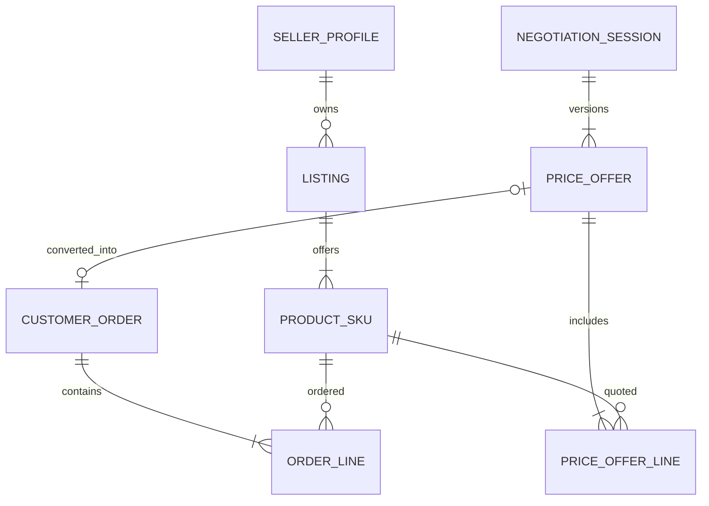

# DEC-SELECTED-SKU-ORDER — buyer checkbox selection and per-line pricing

**Status:** APPROVED product direction, 2026-11-12. Documentation-only, no implemented React/Flutter/backend, no tests executed.

## Buyer journey

Within a seller's Listing, render available 1..N SKU variants with a checkbox, unit label, effective indicative price and quantity input. The client maintains a transient selection state; **do not persist checkbox state as a JPA entity**.

- Unchecked SKU is omitted entirely from the payload and OrderLine collection.
- Quantity is editable only for selected SKU, must be positive, respect unit precision, configured min/max and server-side validation. A selection of zero lines cannot be submitted.
- An SKU may be selected only once per request. Server rejects duplicate conflicting lines or normalizes by formally defined unique SKU semantics before quoting; do not create duplicate reserves.
- One seller per Order, including lines from multiple Listings of that seller (proposed MVP scope). Reject cross-seller contamination on backend independently of UI.
- The UI shows a **provisional price** before submission, not an irrevocable commitment. Server recomputes per-SKU prices, policies, availability mode and total, and presents final authoritative quote/explicit confirmation if changed.
- For TRACKED SKU indicate availability as a recent estimate; **do not reserve on buyer submission**. For UNTRACKED SKU show 'availability to be confirmed', never invent stock or guarantee.
- Listing photo/publication constraints remain; disabled/archived/foreign seller SKUs cannot be ordered.

## Two user commands

**A. Buy at listed prices:** selected `[{skuId, quantity}]` -> server quote -> explicit buyer submit with idempotency key -> one `CustomerOrder(PLACED)` + 1..N immutable `OrderLine`, no InventoryReservation. Seller confirmation validates all TRACKED lines and reserves them atomically before `CONFIRMED`.

**B. Negotiate prices:** selected `[{skuId, quantity, proposedUnitPrice?}]` -> `NegotiationSession` with a versioned whole-set `PriceOffer` and 1..N `PriceOfferLine` preserving SKU+quantity+requested/agreed prices. Seller responds to the whole versioned offer. On AGREED, **buyer explicitly** converts that offer into one `CustomerOrder(PLACED)` with per-line immutable negotiated snapshots. One accepted offer -> at most one Order; no implicit Order when AGREED, and no reservation until seller CONFIRMED. Handling proposals for only a subset of lines must be explicit: unmodified lines carry server-quoted public price and are part of the same offer snapshot.

## Example request contracts (proposed / API S2 required)

```http
POST /api/v1/orders/quotes
Content-Type: application/json

{"lines":[{"skuId":"sku-phone","quantity":"1"},{"skuId":"sku-case","quantity":"2"}]}

POST /api/v1/orders
Idempotency-Key: buyer-generated-opaque-key
Content-Type: application/json

{"quoteId":"q-123","lines":[{"skuId":"sku-phone","quantity":"1"},{"skuId":"sku-case","quantity":"2"}]}

POST /api/v1/negotiations
Content-Type: application/json

{"lines":[{"skuId":"sku-phone","quantity":"1","proposedUnitPrice":"165000.00"},{"skuId":"sku-case","quantity":"2"}]}
```

UUID examples above are conceptual identifiers; actual schema will use validated UUID/public ID types. Price, total, seller identity and inventory are **never trusted from the client**. A quote expires, has price/catalog version and immutable server-side amount; a stale quote is rejected or requires buyer re-acceptance. Define exact quote TTL and KZT rounding during S2.

`POST /api/v1/negotiations/{id}/create-order` requires authenticated buyer and Idempotency-Key after AGREED.

## Canonical relation additions



- `OrderLine`: orderId, skuId, listingId, unit/variant/name snapshots, qty, acceptedUnitPrice, lineTotal, currency=KZT, pricingSource, version; immutable after creation.
- `PriceOfferLine`: offerId, skuId, quantity, publicUnitPriceSnapshot, proposedUnitPrice, agreedUnitPrice, currency, pricingVersion. Version each seller/buyer counteroffer as an immutable set of lines; no silent reuse of outdated unselected SKUs.
- For a listed-price order, `acceptedOfferId` is null. For a negotiated order it is unique and points to a finalized offer.
- `CustomerOrder` status `PLACED` means no stock reservation; `CONFIRMED` after all tracked positions reserved by seller transaction. Grouping warehouse fulfillment is downstream and does not alter OrderLine prices.

## S0 / RED acceptance matrix

| ID | Scenario | Oracle | Test lane |
| --- | --- | --- | --- |
| SELSKU-01 | Buyer checks SKU A,C; leaves B unchecked | Payload and resulting Order have exactly A,C | React/Flutter + H2 |
| SELSKU-02 | Selected quantity 2 for one SKU | Correct immutable quantity, unit and line total, server computed | H2/PostgreSQL |
| SELSKU-03 | No checkboxes selected | Submit disabled in UI, 422/400 server validation | UI/MockMvc |
| SELSKU-04 | Duplicate, inactive, archived, or foreign-seller SKU | Reject; no Order or Outbox mutation | PostgreSQL |
| SELSKU-05 | Buyer submits altered client unit prices | Server ignores prices and requires valid quote; cannot lower total | API/PostgreSQL |
| SELSKU-06 | Published price changes after displayed preview | Stale quote conflicts or explicitly requotes; buyer must accept difference | PostgreSQL |
| SELSKU-07 | Listed-price order with three lines | One PLACED Order, three snapshots, no inventory reservations | PostgreSQL |
| SELSKU-08 | Buyer negotiates two of three selected lines | Versioned PriceOffer has all three lines and unaffected server-quoted price for third | PostgreSQL |
| SELSKU-09 | Seller counteroffer updates one price | Versioned proposal preserves other line terms; no Order until buyer conversion | PostgreSQL |
| SELSKU-10 | Buyer converts accepted offer twice concurrently | One Order and no duplicate OrderLines/Outbox; same idempotent outcome | PostgreSQL concurrency |
| SELSKU-11 | Seller confirms mixed TRACKED/UNTRACKED order | Only TRACKED lines reserve; all-or-nothing status transition | PostgreSQL |
| SELSKU-12 | Tracking stock missing at seller confirm | No reservation created at PLACED; seller confirmation rejects without partial changes | PostgreSQL |
| SELSKU-13 | Buyer changes quantity between quoted and submitted lines | Reject or require fresh quote; no silent quantity change | PostgreSQL |
| SELSKU-14 | Two seller IDs in payload | Rejected as cross-seller; seller of each SKU checked server-side | PostgreSQL security |

## Scope and outstanding decisions

- Approved: checkbox SKU selection, per-SKU quantity, listed-price order or negotiated-price flow, multi-line single-seller basket, reserve at seller confirmation.
- Proposed: exact endpoint naming, quote persistence mechanism/TTL, quantity caps, how many price offer lines may be individually negotiated, and per-order shipment grouping. Independent S2 reviews these before physical JPA model freeze.
- React public storefront currently serves anonymous callback leads, **not authenticated Web Order checkout**. Buyer ordering/negotiation is performed inside Flutter until a separate product decision expands React checkout. Public React may display selected SKUs as a lead/request or an App Link handoff, without covertly creating an Order.

## Approved 2026-11-12 — item origin display and address privacy

- Display **origin city and region for each selected SKU** in buyer-facing quote/negotiation/order screens, including multi-city baskets. Seller-selected location is not necessarily fixed until seller order confirmation; clearly label the city as **preliminary** before confirmation.
- `PriceOfferLine` carries `originCitySnapshot` and `originRegionCodeSnapshot` for the preliminary source locality shown when that offer version was made. It may also contain an optional reference to an eligible public/pickup location; it must never contain private warehouse street, building, unit, phone or coordinates.
- `OrderLine` snapshots `originCitySnapshot` and `originRegionCodeSnapshot` at placement as buyer-visible **provisional sourcing terms**. After seller confirmation, the authoritative allocated source lives in `InventoryReservation -> InventoryLocation` for TRACKED SKU or in an explicit fulfillment/source assignment for UNTRACKED SKU. Retain the originally shown snapshot in history; do not silently overwrite it.
- Full private location address remains only in `InventoryLocation`. A **pickup address** may be disclosed to authorized order participants only when that location is designated as a customer-accessible pickup point. For delivery, show dispatch region/city and the buyer delivery destination in a separate authorized fulfillment/delivery DTO, not as a warehouse address in OrderLine.
- If confirming with a different origin city would change delivery price, timing, pickup city or another material buyer-approved term, do **not** finalize confirmation or reserve stock automatically. Instead move into an explicit proposed-change/awaiting-buyer-consent step (exact state and TTL require S2), show the changed terms and require buyer acceptance before completing seller confirmation. Same-city warehouse substitutions without material changes may be allowed subject to seller inventory and privacy constraints.
- Public API must not enumerate restricted warehouses. City/region displayed before confirmation may be derived from seller-defined eligible fulfillment regions and stock-location availability without exposing private locationId. No exposure of seller warehouse address via PriceOfferLine or anonymous QR storefront.
