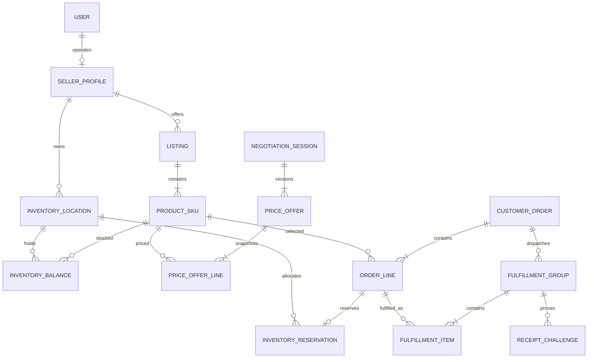

# ZAKAZ / QRM — Entity Registry R0.5

**Status:** consolidated design inventory / S0, **not physical PostgreSQL schema** or implemented Java classes. Created 2026-11-12 against PR #2. The count below tracks **unique named candidates**, not guaranteed table count. Implementation requires RED → S2 → GREEN.

**Baseline:** Java 21, Spring MVC, JPA/Hibernate, PostgreSQL, H2 only for fast test lane, PostgreSQL Testcontainers for database behavior, Redis deferred. `application.time-zone=Asia/Qyzylorda`. Liquibase deferred for development; production requires controlled versioned migrations.

## Registry totals

- **46 distinct tracked candidates**: 28 original main ER labels + 11 additionally named in architecture + 7 subsequent candidates (`InventoryMovement`, `IdempotencyRecord`, `CancellationRequest`, `ReceiptChallenge`, `FulfillmentGroup`, `FulfillmentItem`, `PriceQuote`).
- Work priority: **P0 27**, **P1 12**, **P2 7**. P0 indicates *business critical for the intended first trading vertical slice*, **not** that all must be coded in a single PR.
- `@Entity` vs enum/value-object distinctions remain explicit; do not create tables for every label.

## Canonical registry

| # | Name | Owning context | Mapping proposal | Priority | Principal fields / FK | Invariants and notes |
|---:|---|---|---|---|---|---|
| 1 | `User` | identity,seller | ENTITY | P0 | id; normalized phone alias; status; version | phone unique but unverified; no phone-only recovery |
| 2 | `UserRole` | identity,seller | ENTITY/ASSOCIATION | P0 | userId; role | unique(userId,role); use Role enum, not extra Role dictionary initially |
| 3 | `SellerProfile` | identity,seller | ENTITY | P0 | id; ownerUserId; slug; logoMediaId | unique(slug), owner ACL |
| 4 | `Category` | catalog,listing,media | ENTITY | P0 | id; parentId?; active | tree rules; no cycle |
| 5 | `Product` | catalog,listing,media | ENTITY | P0 | id; categoryId; productType | not seller price or stock |
| 6 | `Listing` | catalog,listing,media | AGGREGATE ROOT | P0 | id; sellerId; productId; status | 1..N SKU; ownership; publication guard |
| 7 | `ProductSku` | catalog,listing,media | ENTITY | P0 | id; listingId; skuCode; attributes; stockTrackingMode | seller scoped code; TRACKED/UNTRACKED |
| 8 | `ListingTranslation` | catalog,listing,media | ENTITY | P0 | listingId; locale; title; description | unique(listingId,locale) |
| 9 | `ListingMedia` | catalog,listing,media | ENTITY | P0 | listingId; mediaId; displayOrder | unique order; do not embed binary |
| 10 | `MediaObject` | catalog,listing,media | ENTITY | P0 | id; storageKey; mime; size; status | S3 reference, access policy |
| 11 | `ListingVideo` | catalog,listing,media | ENTITY/OPTIONAL | P2 | listingId; externalUrl; status | defer if YouTube optional |
| 12 | `MeasurementUnit` | catalog,listing,media | ENUM/VO | P0 | PCS;KG;G;L;ML;M;M2;M3;HOUR;SERVICE;LICENSE | value object/enum; not default table |
| 13 | `PricingTier` | pricing,negotiation | ENTITY | P1 | skuId; minQty; maxQty; unitPrice | non-overlap per SKU, KZT |
| 14 | `DiscountCampaign` | pricing,negotiation | ENTITY | P1 | scope; validFrom; validUntil; amount | single effective rule; explicit precedence |
| 15 | `NegotiationSession` | pricing,negotiation | AGGREGATE ROOT | P0 | id; buyerId; sellerId; status; version | up to 5 counters; no Order yet |
| 16 | `PriceOffer` | pricing,negotiation | ENTITY | P0 | id; sessionId; roundNo; status; expiresAt | immutable versioned offer, single accepted |
| 17 | `PriceOfferLine` | pricing,negotiation | ENTITY | P0 | offerId; skuId; qty; proposedPrice; originCitySnapshot | complete set of selected lines; city preliminary |
| 18 | `PriceQuote` | pricing,negotiation | ENTITY OR SIGNED VO | P1 | quoteId; lineSnapshot; version; expiry | persist only if quote and replay requirements demand it |
| 19 | `InventoryLocation` | inventory | ENTITY | P0 | id; sellerId; code; regionCode; city; structuredAddress; active | unique(sellerId,code); private addresses |
| 20 | `InventoryBalance` | inventory | ENTITY | P0 | locationId; skuId; onHand; reserved; version | unique(locationId,skuId); 0<=reserved<=onHand |
| 21 | `InventoryReservation` | inventory | ENTITY | P0 | orderLineId; locationId; skuId; quantity; status | created only on seller CONFIRMED; active guard |
| 22 | `InventoryMovement` | inventory | ENTITY | P0 | locationId; skuId; onHandDelta; reservedDelta; correlation | append-only, idempotent adjustments |
| 23 | `CustomerOrder` | order,fulfillment | AGGREGATE ROOT | P0 | id; publicNumber; buyerId; sellerId; status; version | unique(publicNumber); one seller; PLACED no reserve |
| 24 | `OrderLine` | order,fulfillment | ENTITY | P0 | orderId; skuId; qty; priceSnapshot; originCitySnapshot | 1..N lines; immutable economic values |
| 25 | `OrderStatusHistory` | order,fulfillment | ENTITY | P0 | orderId; oldStatus; newStatus; actor; at | append-only evidence |
| 26 | `IdempotencyRecord` | order,fulfillment | ENTITY | P0 | actorId; operation; key; requestHash; resultRef | unique(actor,operation,key); retry-safe |
| 27 | `CancellationRequest` | order,fulfillment | ENTITY | P1 | orderId; requesterId; reason; status | separate from status and claims |
| 28 | `Fulfillment` | order,fulfillment | AGGREGATE ROOT / REFACTOR | P0 | orderId; fulfillmentType; status | review move to group-driven completion |
| 29 | `FulfillmentGroup` | order,fulfillment | ENTITY | P0 | orderId; groupNo; type; status; source/destination | multiple groups per order, grouped receipt |
| 30 | `FulfillmentItem` | order,fulfillment | ENTITY | P0 | groupId; orderLineId; quantity | source allocation and partial fulfillment guard |
| 31 | `ReceiptChallenge` | order,fulfillment | ENTITY | P0 | groupId; tokenHash; expiresAt; consumedAt | one-time QR, buyer explicit consent |
| 32 | `ReturnClaim` | order,fulfillment | ENTITY | P1 | orderId; reason; status; evidence | cannot rewrite completed history |
| 33 | `ReturnReason` | order,fulfillment | ENUM OR DICTIONARY | P1 | code; locale label | enum now; data-driven only if moderation/config required |
| 34 | `QrCode` | qr,lead,favorite | ENTITY | P1 | id; listingId; publicId; sourceTag | stable public ID, not receipt proof |
| 35 | `PurchaseLead` | qr,lead,favorite | ENTITY | P1 | listingId; sellerId; phoneEncrypted; consent | Web callback only; no auto order |
| 36 | `Favorite` | qr,lead,favorite | ENTITY | P2 | userId; listingId | unique(userId,listingId) |
| 37 | `FavoritePriceWatch` | qr,lead,favorite | ENTITY/OPTIONAL | P2 | favoriteId; qty; threshold | can embed in Favorite if 1:1 |
| 38 | `ProductReview` | rating,analytics,notification | ENTITY | P1 | orderId; line/sku target; rating; status | verify receipt eligibility and target |
| 39 | `SellerReview` | rating,analytics,notification | ENTITY | P1 | orderId; sellerId; rating; status | independent from ProductReview |
| 40 | `ListingViewEvent` | rating,analytics,notification | ENTITY/EVENT | P2 | listingId; attribution; visitorHash; at | retention/anti-bot; postpone if unneeded |
| 41 | `DailyAnalyticsAggregate` | rating,analytics,notification | DEFERRED ENTITY | P2 | listingId; businessDate; views | not required for initial order flow |
| 42 | `NotificationPreference` | rating,analytics,notification | ENTITY | P1 | userId; channels; marketingOptIn | unique(userId) |
| 43 | `PushDevice` | rating,analytics,notification | ENTITY | P2 | userId; tokenHash; platform | optional FCM, separate from center |
| 44 | `NotificationDelivery` | rating,analytics,notification | ENTITY | P2 | notificationId; channel; attempts; state | delivery history; needs persisted inbox model |
| 45 | `OutboxEvent` | rating,analytics,notification | ENTITY | P0 | eventId; aggregateId; type; payload; state | same transaction as order/reservation |
| 46 | `AuditEvent` | rating,analytics,notification | ENTITY/EVENT | P1 | actor; action; old/new; traceId; at | PII-minimized audit |

## Enum registry (not extra entities)

| Enum / value object | Values (initial proposal) | Owner / rule |
|---|---|---|
| `ProductType` | `PHYSICAL, SERVICE, DIGITAL` | catalog; type-specific fulfillment |
| `MeasurementUnit` | `PCS, KG, G, L, ML, M, M2, M3, HOUR, SERVICE, LICENSE` | catalog; quantity precision and conversion policy |
| `ListingStatus` | `DRAFT, PUBLIC, UNLISTED, ARCHIVED` | listing publication matrix |
| `StockTrackingMode` | `TRACKED, UNTRACKED` | SKU policy, no fabricated stock |
| `InventoryReservationStatus` | `ACTIVE, CONSUMED, RELEASED` | inventory; expiry needs reviewed transition |
| `InventoryMovementKind` | `RECEIPT, ADJUSTMENT, RESERVE, RELEASE, CONSUME` | inventory; journal stores signed deltas |
| `OrderStatus` | `PLACED, CONFIRMED, PROCESSING, CANCELLATION_REQUESTED, COMPLETED, CANCELLED_BY_BUYER, CANCELLED_BY_SELLER, CANCELLED` | order, review legal transitions |
| `NegotiationStatus` | `OPEN, COUNTER_PENDING, AGREED, REJECTED, WITHDRAWN, EXPIRED, ORDER_CREATED` | negotiation; order creation is explicit buyer action |
| `FulfillmentType` | `PICKUP, DELIVERY, SERVICE, DIGITAL` | fulfillment; no physical `IN_TRANSIT` for digital |
| `FulfillmentGroupStatus` | `PENDING, PREPARING, READY_FOR_RECEIPT, RECEIVED, CANCELLED, DISPUTED` | proposal pending exact per-type S2 |
| `ReceiptChallengeStatus` | `ISSUED, CONSUMED, EXPIRED, REVOKED` | receipt; proof is buyer action, not mere QR scan |
| `CurrencyCode` | `KZT` | price/order snapshots, explicit currency |
| `UserRoleType` | `BUYER, SELLER, ADMIN` | identity; future staff permission separate |
| `ReviewModerationStatus` | `PENDING, PUBLISHED, HIDDEN, REJECTED` | rating |
| `OutboxStatus` | `NEW, CLAIMED, PUBLISHED, FAILED` | infrastructure, leases/replay to qualify |

Use `EnumType.STRING`, never `ORDINAL` in JPA. Database checks/migrations must account for enum evolution, and historical states must not be silently renamed.

## Value objects / embedded snapshots (not necessarily standalone tables)

- `Money` (BigDecimal + currency), `Quantity` (positive + unit precision), `Address` (regionCode/name, settlement, street/building/unit), `GeoPoint` (latitude/longitude), `OriginLocalitySnapshot` (city + region + provisional flag).
- `OrderLinePriceSnapshot` and `PriceOfferLinePriceSnapshot`: source price version, qty, unit price, total, rounding version; immutable after commit.
- `OrderNumber`: immutable `ZK-XXXX-XXXX`; `OrderNumberGenerator` is a **domain service, not a JPA entity**. PostgreSQL unique constraint is final guard; random number is not an access credential.
- `InventoryAvailableQuantity` is derived from `InventoryBalance.onHand - reserved`; not a stored entity; temporary checkbox selection state belongs to UI.
- `PriceBook`, `QrCampaign`, `Review`, `ViewAggregate`, `SellerInboxItem` are conceptual aggregate/projection names from earlier drafts; they must not automatically become *additional tables* on top of PricingTier, QrCode, ProductReview/SellerReview, counters and notification projections.

## Required supporting storage outside 46 counted candidates

These are **not yet normalized into the 46-count** and require a separate design decision before migration. This distinction prevents false precision in the total.

| Candidate | Why | Decision |
|---|---|---|
| `PasswordCredential`, `RefreshSession`, `RecoveryFactor` | credential/session security; password hash, revocation, verified email | P0 identity design; likely entities, not derived |
| `UserNotification`, `SellerInboxState` | persistent notification center and independent seller read/bookmark state | P1, verify separation and unread versioning |
| `ProfileAggregationRun`, `BuyerProfileSnapshot`, `SellerProfileSnapshot`, `SellerBuyerProfileSnapshot`, `ProfileSnapshotPointer` | nine-month background qualification and atomic publication | P2 after verifiable receipt/review source, no eager tables |
| `FulfillmentAllocation` | if an OrderLine can be split across multiple locations independently of FulfillmentItem | defer; clarify R1 one-location-per-line rule |
| `EffectivePriceChanged` | domain event/outbox payload | not a business entity unless auditing demands separate storage |

## Key relationships and invariants

- One CustomerOrder belongs to one seller (proposed MVP scope) and has one or more lines; cross-seller items reject/split before persistence.
- Buyer selects 1..N SKU checkboxes, server recomputes per-SKU amounts; unselected SKU does not become OrderLine.
- PLACED does **not** reserve. On seller confirmation, all TRACKED line demands are aggregated by `(locationId,skuId)`, reserved atomically with deterministic key order; if any insufficient or missing balance, rollback all lines, movement and outbox.
- `InventoryLocation` private structured region/city/address; `PriceOfferLine` and `OrderLine` show immutable **preliminary origin city/region snapshots**. Confirmed source and allowed public pickup address are served through authorized fulfillment DTOs. Material changes require buyer consent before reserve.
- `InventoryReservation` is NOT required for UNTRACKED SKU. Tracking mode changes with active reservations are blocked.
- `CustomerOrder.publicNumber` uses approved `ZK-XXXX-XXXX` randomly generated, PostgreSQL UNIQUE, bounded collision retry. Printed persistent QR cannot authorize receipt.
- `FulfillmentGroup` handles delivery/pickup/service acceptance; receipt QR is separately one-time, expiring, authenticated, non-replayable.
- JPA mappings must avoid cross-context entity graph coupling; use UUID references or application interfaces across bounded contexts; no blanket `CascadeType.ALL` or EAGER chains.

## Decision log / blocking S2 items

1. Finalize line-vs-basket negotiation offer semantics, discounts, snapshot precedence and mixed price versions.
2. Confirm one seller per Order; within a seller, decide allowed multi-city dispatch/fulfillment splitting and partial receipt status presentation.
3. Define reserve consumption/release at handover, cancellation, dispute and expiry; ensure inventory ledger balances.
4. Confirm whether Quote is durable `PriceQuote` or signed/versioned value object.
5. Choose schema migrations before production (Hibernate update dev only; H2 tests not substitute for PostgreSQL constraints).
6. Reconcile legacy master REQUIREMENTS 'one Listing per Order', reactive references and Asia/Almaty nightly cutoff with current approved choices.
7. Review KZT rounding/legal requirements and seller-selected untracked-stock disclosure.

## Proposed implementation slices

- **R1a:** Maven Java 21 foundation; enumerations/value objects; User/SellerProfile security foundation and basic catalog/Listing/ProductSku; fast H2 tests.
- **R1b:** InventoryLocation/Balance and Order/OrderLine, OrderNumber generator/uniqueness; PostgreSQL Testcontainers transactional tests.
- **R1c:** Seller CONFIRMED reserve, Reservation/Movement/Outbox; negative, concurrency, rollback and replay tests.
- **R1d:** Negotiation/PriceOfferLine and quote acceptance; fulfillment groups/receipt challenges; security tests.
- **Later:** optional price alerts, advanced analytics, review image pipelines, daily counters and multi-location partial split.

## First RED tests and acceptance criteria

- `NUM-01…NUM-06`: generation format, uniqueness, idempotent retry and persistence.
- `SELSKU-01…SELSKU-14`: selected SKU quantities, seller ownership, price snapshots.
- `INV-01…INV-25`: tracked/untracked reservation on seller confirm, stock race, duplicate lines aggregate, rollback and location authorization.
- `LOC-01…LOC-09`: preliminary city snapshots, address privacy and consent to material origin change.
- `QR-01…QR-06`: separate printed locator vs secure receipt proof.
- Add `REG-01` ArchUnit proof no circular module dependencies, `REG-02` no `EnumType.ORDINAL`, `REG-03` database UNIQUE/CHECK constraints run on PostgreSQL.

**Qualification status:** registry completed at S0 only; no executable Java entities, generator, PostgreSQL migration or CI results are claimed.

## Геолокация точек хранения и выдачи (2026-11-12)

`InventoryLocation` хранит необязательную пару координат WGS84 (`latitude`, `longitude`), регион, город, адрес, `LocationType` и разрешение публичного самовывоза. `GeoPoint` — Java value object, а не дополнительная таблица. Закрытые склады не раскрывают точные координаты покупателям. Для будущей доставки исходная точка должна браться из подтверждённого распределения заказа, пункт назначения — только из разрешённого адреса клиента. См. [DEC-LOCATION-GEOPOINT](DEC-LOCATION-GEOPOINT.md). PostGIS и маршрутизация отложены до появления измеренной потребности.

## Buyer Web catalog follow-up (2026-11-12)

See [DEC-BUYER-WEB-CATALOG](DEC-BUYER-WEB-CATALOG.md). Dynamic category characteristics may require `CategoryAttributeDefinition` plus typed `ListingAttributeValue` / `SkuAttributeValue` **additional candidates beyond 46**. Their cardinality and mapping must be decided in S2 after catalog API contract and indexing tests. Current React prototype has no server entities and does not increase implemented JPA table count.

## Java ML рекомендации — ADR-003

Утверждён стек **Java 21 + Spring Boot + PostgreSQL + Tribuo** в модульном монолите. Для персонализации и рекомендательных Push определены кандидаты `BuyerInteractionEvent`, `BuyerInterestProfile`, `MlTrainingRun`, `MlModelVersion`, `RecommendationFeedback` и возможный `NotificationDecision`; `RecommendationFeatures` — value object, а не JPA entity. Состав таблиц не расширять автоматически; использовать уже имеющиеся Favorite/analytics/notification/outbox контракты. Подробнее: [ADR-003-JAVA-ML-RECOMMENDATIONS.md](ADR-003-JAVA-ML-RECOMMENDATIONS.md). Реального обучения, ML-инференса и отправки Push пока нет.
