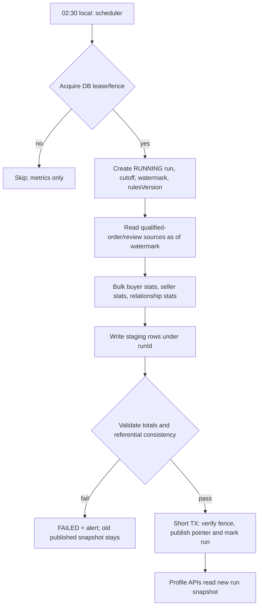

# QRM — Nightly Profile Aggregation v1 (NPA-01)

**Status:** implementation-ready design, not executable production code. **Decision:** nightly aggregation for buyer + seller profiles, approved concept; numerical tier thresholds remain proposals.  
**Stack:** Spring WebFlux + R2DBC + PostgreSQL; Liquibase (separate JDBC migration job); single modular monolith.  
**Inputs:** [DEC-24 customer activity](CUSTOMER-ACTIVITY-AGGREGATOR.md), [domain contracts](DOMAIN-CONTRACTS.md).

## 1. Goal, scope and explicit boundaries

Each night materialize **both** buyer and seller nine-month profile metrics as a consistent, versioned snapshot. React seller page and Flutter buyer/seller profile read a **published snapshot**; never run nine-month aggregation on a user's GET. Seller dashboard may show latest available snapshot with `calculatedAt`. All profiles (including those with zero completed deals or inactive this month) must be considered; source cohort comes from `User` / `SellerProfile`, **not only from current-month partitions**.

Do not infer payment completion from QRM status: QRM does not process money. A qualifying transaction requires a real Order and verifiable fulfillment/receipt according to product type. Self-dealing, cancellation-only, fabricated review and anonymous callback lead cannot upgrade a tier. Repeat buyers are counted within the seller's own orders only. Seller rating uses eligible review data, not completed-order counts.

### Explicit consistency contract

- Snapshot **cutoff** = start of scheduled business day in `Asia/Almaty`, mapped to a single UTC instant. Query `event_time < cutoffUtc`; nine-month lower boundary = cutoff minus 9 calendar months in merchant/platform timezone then convert to UTC; window `[windowStartUtc, cutoffUtc)`. Store both instants in run metadata.
- Snapshot is **as-of last nightly cutoff**, not real-time. Latest order/return may not appear until next run. This is disclosed in UI.
- Same `cutoffUtc + rulesVersion` rebuild is deterministic; rerun replaces only its draft data and cannot duplicate totals.
- To avoid modifying already published snapshots, worker creates a new `run_id` and writes staging rows; a short final transaction atomically changes `active_run_id`. Existing published snapshot stays visible on failure.
- Late corrections to an older period are included in the next full-window rebuild; corrections beyond the window can affect lifetime/seller history and require a bounded historical correction path.
- The pipeline does **not** set transaction states and does **not** send marketing push.

## 2. Schedule and coordination

| Control | Default proposal |
|---|---|
| Run time | 02:30 Asia/Almaty daily |
| Cutoff | 00:00 Asia/Almaty on run date, exclusive |
| Catch-up | If the job was missed, run for the latest intended cutoff; optional bounded historical backfill for auditing |
| Retry | bounded exponential retry after recoverable DB failures, with metrics and alert |
| Max duration | 60 minutes (configurable, measure at actual scale) |
| Leader election | PostgreSQL advisory transaction lock or durable leased job lock; never rely on in-memory single-node assumption |
| Rebuild | privileged manual operation with explicit `asOfDate` and `rulesVersion`; full record of actor and reason |
| Old staging cleanup | delete stale unpublished runs only after configured safety retention |
| Previous snapshot | continue serving until new run is published |

**Concurrency:** `unique(job_name, as_of_date, rules_version)` logical job key; claim with atomic compare-and-set lease. Transaction-scope advisory locks cannot cover long async jobs; use durable lease + heartbeat and compare-and-set publish. Lease ownership + epoch fencing is validated before stage writes and publish, so expired worker cannot overwrite a successor.

**Time:** QRM serves Kazakhstan first; daylight-saving assumptions are not hardcoded. Java `ZoneId.of("Asia/Almaty")`, not fixed UTC offset.

## 3. Minimal database design (proposed Liquibase schemas)

Source of truth = qualified Order/Fulfillment and eligible review events, not raw QR views.

```sql
-- Illustrative DDL only; place in versioned Liquibase migration after S2 approval.
CREATE TABLE profile_aggregation_run (
  run_id uuid PRIMARY KEY,
  job_name varchar(48) NOT NULL,
  as_of_date date NOT NULL,
  cutoff_at timestamptz NOT NULL,
  window_start_at timestamptz NOT NULL,
  rules_version integer NOT NULL,
  generation bigint NOT NULL,
  state varchar(20) NOT NULL,
  started_at timestamptz NOT NULL,
  finished_at timestamptz,
  lease_owner varchar(128),
  lease_until timestamptz,
  source_watermark timestamptz,
  error_code varchar(100),
  CHECK (state IN ('RUNNING','STAGED','PUBLISHED','FAILED','SUPERSEDED'))
);
CREATE INDEX profile_run_day_idx
 ON profile_aggregation_run(job_name, as_of_date, rules_version, generation DESC);

CREATE TABLE buyer_profile_snapshot (
  run_id uuid NOT NULL REFERENCES profile_aggregation_run(run_id),
  buyer_id uuid NOT NULL,
  qualifying_orders_9m integer NOT NULL,
  active_months_9m integer NOT NULL,
  last_qualified_at timestamptz,
  trade_tier varchar(32) NOT NULL,
  lifecycle_segment varchar(32) NOT NULL,
  PRIMARY KEY (run_id,buyer_id)
);

CREATE TABLE seller_profile_snapshot (
  run_id uuid NOT NULL REFERENCES profile_aggregation_run(run_id),
  seller_id uuid NOT NULL,
  qualifying_orders_9m integer NOT NULL,
  repeat_buyers_9m integer NOT NULL,
  rating_sum numeric(18,4) NOT NULL,
  rating_count integer NOT NULL,
  trade_tier varchar(32) NOT NULL,
  last_qualified_at timestamptz,
  PRIMARY KEY (run_id,seller_id)
);

CREATE TABLE seller_buyer_profile_snapshot (
  run_id uuid NOT NULL REFERENCES profile_aggregation_run(run_id),
  seller_id uuid NOT NULL,
  buyer_id uuid NOT NULL,
  qualifying_orders_9m integer NOT NULL,
  last_order_at timestamptz,
  relationship_segment varchar(32) NOT NULL,
  PRIMARY KEY (run_id,seller_id,buyer_id)
);

CREATE TABLE profile_snapshot_pointer (
  job_name varchar(48) PRIMARY KEY,
  active_run_id uuid NOT NULL REFERENCES profile_aggregation_run(run_id),
  published_at timestamptz NOT NULL
);
```

Schema details to finalize: UUID types matching identity/order models, rating source/eligibility scope, live/archived profiles, indexes, on-delete policy, validated nonnegative counts, retention of historical runs, permission boundaries and source watermark semantics.

**R2DBC:** no ORM lazy relationships; bulk `DatabaseClient` queries and batch writes. No one large transaction around long aggregation. Draft run data is inert until active pointer publish.

## 4. Data calculation and source queries

**Qualifying order:** one per unique `order_id` whose qualifying fulfillment occurred in the window and before cutoff, excluding cancelled/non-fulfilled states; a later full return affects counting according to approved returns policy. Partial returns require future quantity-aware rule. Untrusted manual `COMPLETED` alone is insufficient for a public claim of payment.

**Buyer aggregate:** count distinct qualifying order IDs, count distinct calendar months (using local business date in Asia/Almaty) with qualifying orders, last qualifying event time. Compute lifecycle independently from tier. Do not equate zero current-month records with zero 9M.

**Seller aggregate:** count distinct qualifying orders associated with seller; count repeat buyers as distinct verified buyers with >=2 qualifying orders **with this seller within 9M**; separate sum/count of **eligible, non-hidden, non-duplicated seller ratings** under approved rating policy; no rating if count=0. Seller trade tier uses counts only; star rating independently calculates `rating_sum/rating_count` and displays sample size.

**Relationship:** each seller/buyer pair with verified history from approved orders; `NEW_TO_SELLER` (no qualified past order), `BOUGHT_BEFORE` (1–2), `REGULAR` (>=3) for the 9M proposal. A seller may only read their own rows; do not derive account identity from an anonymous Web callback phone.

**Event-time versus state:** current Order state alone is insufficient to reconstruct historical windows after returns/corrections. Aggregator must read an audited source of fulfillment state transitions (versioned event journal) or a qualified-order projection carrying `qualified_at`, `reversed_at`, and source versions. Design must pin a repeatable `source_watermark` before calculation so concurrent writes cannot produce partial cross-table snapshots.

**Partitioning:** raw business events MAY use monthly PostgreSQL RANGE partitions, but for initial MVP normal indexes are sufficient. Daily/monthly summaries may be materialized later; nightly worker can aggregate 9M through indexed transactional projections. Do not require current-month partition membership to qualify a buyer/seller. Do not drop old partitions based only on 9M score window.

## 5. Nightly processing steps



Invariants before publish:
- Every eligible user/seller included, including users with zero purchases (fallback row/tier or explicit no-history state).
- `sum(buyer qualifying_orders)` reconciled with qualified orders; seller orders cross-check seller projection (careful multi-role orders).
- `rating_count >= 0`, no rating average for zero count; trade tiers valid for pinned `rulesVersion`.
- No negative counts, duplicate composite keys, unlinked seller profiles, or leakage across sellers.
- Staged row counts and checksum recorded; large count deviations flagged rather than blindly publishing.

## 6. Profile read contracts

```http
GET /api/v1/me/trade-profile
GET /api/v1/sellers/{slug}/reputation
GET /api/v1/seller/customers/{buyerUserId}/relationship
GET /api/v1/seller/profile/analytics-summary
```

Sample buyer:
```json
{
  "buyerId": "opaque-id",
  "tier": "MERCHANT",
  "activitySegment": "ACTIVE",
  "qualifyingOrders9m": 12,
  "activeMonths9m": 4,
  "windowStart": "2026-02-11T19:00:00Z",
  "windowEnd": "2026-11-11T19:00:00Z",
  "calculatedAt": "2026-11-12T03:00:00Z",
  "rulesVersion": 1,
  "dataStatus": "CURRENT"
}
```
Sample seller public reputation: `{ "tier":"MASTER", "ratingAverage":"4.75", "ratingCount":40, "qualifyingOrders9m":86, "asOf":"...", "dataStatus":"CURRENT" }`. `ratingAverage=null` when no eligible ratings. Seller/customer relationship details are private, returned only to participating seller for identified buyer. Public score is an activity proxy, not a creditworthiness/payment guarantee.

HTTP read fallback: if no published run, show `NO_DATA` and basic profile without fabricated zero/negative reputation. On stale last run, `dataStatus=STALE` with timestamp, not silent fresh metrics.

## 7. Testing: S0 → RED → S2 → GREEN

| ID | Test / fault injection | Required result |
|---|---|---|
| NPA-01 | User registered but no current-month record | profile exists, historical 9M tier unchanged |
| NPA-02 | 9M boundary exact cutoff, month/day and timezone transition | only events in [start,end), exact event-time membership |
| NPA-03 | Same confirmed order observed through multiple events | counted once |
| NPA-04 | Full return after completion | corrected next run, no duplicate/negative |
| NPA-05 | Worker killed after staging | old published pointer untouched |
| NPA-06 | Lease expires and second worker starts | fenced stale worker cannot publish |
| NPA-07 | Re-run same cutoff/rulesVersion | deterministic values, no duplicate active snapshot |
| NPA-08 | User has buyer + seller roles | independent scores |
| NPA-09 | Buyer buys from sellers A and B | relationship isolated; no cross-seller disclosure |
| NPA-10 | Three orders at one seller | REGULAR; cancelled orders excluded |
| NPA-11 | No eligible seller reviews | ratingAverage null, ratingCount=0 |
| NPA-12 | Review removed by moderation | seller rating corrected on rebuild |
| NPA-13 | Source transactions during run | consistent watermark/snapshot, no mixed totals |
| NPA-14 | Snapshot validation fails | no publish, error logged, alert |
| NPA-15 | No snapshot after initial install | NO_DATA fallback, no error to public page |
| NPA-16 | Missed nightly schedule | controlled catch-up, no concurrent duplicate |
| NPA-17 | Manual backfill and current run overlap | active pointer remains newest allowed cutoff |
| NPA-18 | 100k+ orders across time partitions | bounded memory, indexed scans, no event-loop blocking |
| NPA-19 | Unauthorized seller reads another seller/customer pair | 403/404 no cross-seller stats |
| NPA-20 | Order fulfilled without payment evidence | no false `paid` label |

Unit tests: ranking boundaries and lifecycle. Integration: R2DBC + Testcontainers PostgreSQL + real Liquibase migrations. Scheduler: fake clock and lease-expiry tests. API: WebTestClient. Runtime: metrics and restart tests.

## 8. Monitoring and rollout

Metrics: `profile_aggregation_last_success_epoch`, `profile_aggregation_duration_seconds`, `profile_aggregation_lag_hours`, `profile_aggregation_failed_runs_total`, `profile_aggregation_staged_rows`, `profile_aggregation_reconciliation_errors`, `profile_snapshot_stale_age_hours`. Alert when run fails, snapshot older than 36 hours, or invalid reconciliation. Include `runId`, cutoff and rulesVersion in structured logs, no phone/address.

**Rollout:** (1) DB/queries/tests; (2) run shadow aggregation without publishing; (3) compare on known test cohort; (4) enable publishing behind feature flag; (5) read-only APIs; (6) UX. Do not grant discounts/deny buyer offers automatically from score.

**Dependencies:** exact Order/Fulfillment historical qualification semantics, seller review eligibility/moderation, seller/customer identity verification, timezone and tier threshold review. **Not yet implemented.**

## Lean MVP reduction (architecture review)

**Required first:** audited qualified-fulfillment projection, eligible-review source, one scheduled worker with buyer/seller/seller-buyer snapshots, atomic publication, anti-replay and privacy checks. **Not required at launch:** materializing separate `customer_daily_stats` and `customer_monthly_stats`, raw event monthly partitions, stream processing, data warehouse. If indexed historical source cannot meet runtime targets, introduce supplemental rollups after profiling. Source data event-time and corrections remain mandatory; snapshot must expose as-of and STALE status. See [TECHNICAL-REVIEW-MVP.md](TECHNICAL-REVIEW-MVP.md).
