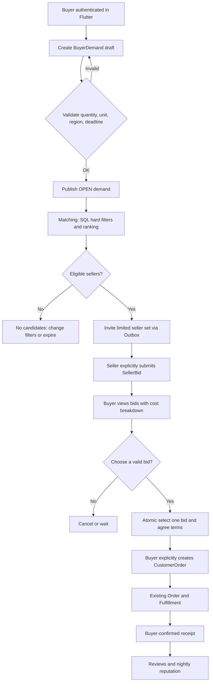
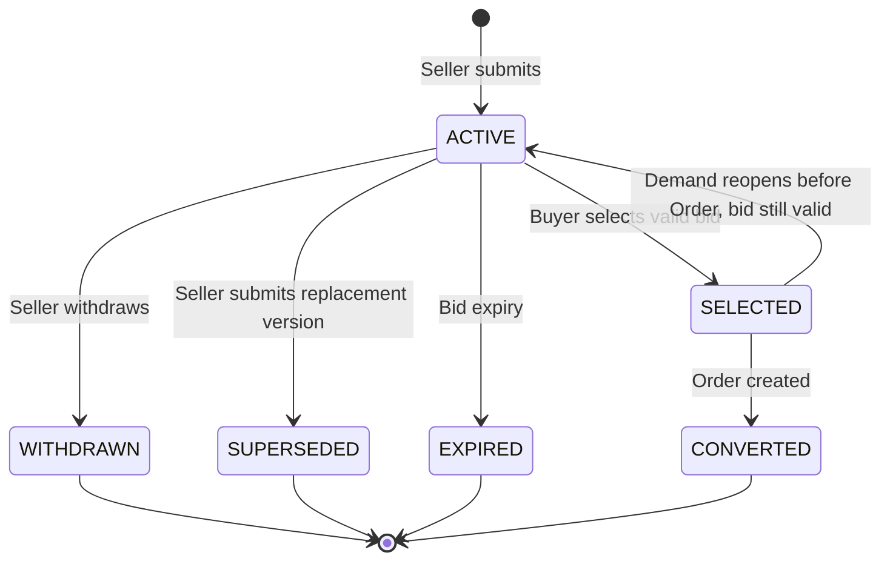

# QRM Smart Deal — R2 Functional Specification (SD-R2)

**Status:** S0 / proposed feature, not an approved expansion of MVP P0 and not implemented.  
**Scope:** `BuyerDemand → Candidate Matching → SellerBid → accepted offer → explicit CustomerOrder`.  
**Baseline:** [REQUIREMENTS](REQUIREMENTS.md), [DOMAIN-CONTRACTS](DOMAIN-CONTRACTS.md), [API-SPEC](API-SPEC.md), [USER-JOURNEYS-MVP](USER-JOURNEYS-MVP.md), [AUTH-NOTIFICATIONS](AUTH-NOTIFICATIONS.md), [MVP DEC R0.3](MVP-DECISIONS-R03.md).  
**Naming:** SD-R2 is the **Smart Deal feature design milestone**, not the existing implementation roadmap's R2 catalog milestone. **No extra service, queue or ML model is required in the first release.**

## 1. Product hypothesis

Buyer publishes one authenticated request for a product with quantity, delivery/pickup geography and optional budget/deadline. QRM finds *eligible* seller listings, invites a bounded set of sellers to send **explicit seller bids**, and transparently compares accepted bids. Buyer deliberately selects **one bid** and then deliberately creates **one Order** using the existing `NegotiationSession / CustomerOrder / Pricing / Outbox` machinery. QRM does **not** process payment, guarantee delivery, guarantee stock, or reserve stock merely by demand/bid.

**Why it might matter:** less time comparing offers; sellers see concrete qualified demand instead of generic page views. Validate by conversion into **buyer-confirmed received Orders**, not clicks or model accuracy.

### Hard boundaries

- Smart Deal is authenticated **Flutter Buyer** functionality; anonymous React Web form stays **PurchaseLead for callback only**, never creates BuyerDemand, SellerBid or Order.
- Seller may answer in authenticated Flutter Seller; React Seller Cabinet may display/respond **only if** its existing browser-bound QR authentication and session authorization have passed security acceptance.
- One Smart Deal request targets one product class and compatible unit, one seller winner, **one Listing per Order** in this version; no split fulfillment, multi-seller basket, auction/escrow, auto-accept or payment orchestration.
- The system must not insert a bid or order on seller's behalf; candidate matching is only a recommendation to invite.
- Scoring/fraud ML is optional later and must never override filters, owner authorization, pricing, buyer's explicit action or eligibility.
- The seller sees request requirements, approximate location and budget **only when buyer explicitly elected to show it**; never buyer's phone, address or private history in the matching stage.

## 2. Roles and UX journeys

| ID | Actor | Entry/action | UI result | Business result |
|---|---|---|---|---|
| SD-UX-01 | Flutter Buyer | Open Smart Deal / create draft | Item, quantity/unit, city, optional budget, deadline | `BuyerDemand DRAFT` |
| SD-UX-02 | Flutter Buyer | Publish valid demand | Open request and matched candidates | `OPEN`, immutable request version, source event |
| SD-UX-03 | QRM matcher | Fetch eligible listings by category/unit/region | Number of matches with clear limitations | Sorted `MatchCandidate` projection, no Order |
| SD-UX-04 | Seller | Receive in-app invitation | Demand summary, hide private buyer data | Inbox/notification by event, seller may ignore |
| SD-UX-05 | Seller | Submit explicit bid | Own bid price, qty, terms, expiry | `SellerBid ACTIVE`; validated against own Listing |
| SD-UX-06 | Buyer | Compare bids | Full comparable price + separate shipping/unknown costs, availability, reputation | Read-only projection; no state transition |
| SD-UX-07 | Buyer | Choose bid | Explicit confirm terms / compare snapshot | `SELECTED` demand + bid; link agreed offer |
| SD-UX-08 | Buyer | Press Create Order | Order details, final total, receipt expectations | Exactly one `CustomerOrder PLACED` through existing conversion; demand `ORDER_CREATED` |
| SD-UX-09 | Seller/Buyer | Fulfill / confirm receipt using existing protocol | Normal order, dispute and review screens | `READY_FOR_RECEIPT → RECEIVED → COMPLETED` when qualified |
| SD-UX-10 | Buyer | Withdraw before selection | Closed request | `CANCELLED`; no new bids/orders |
| SD-UX-11 | Seller | Withdraw/replace own active bid | Updated offer info | Old version no longer selectable, audit maintained |
| SD-UX-12 | Buyer | Follow QR to exact listing then ask alternatives in Flutter | Pre-filled demand form after consent | Existing QR attribution untouched; not Web callback conversion |

**Error/empty UX:** no eligible sellers (edit requirements or return later), no bids before expiry, seller declined, bid expired, listing archived, price/stock changed, network retry, duplicate click, no push permission. No false promise of delivery or payment guarantee.

## 3. Main user path



## 4. State machines and ownership

### BuyerDemand (aggregate root in smartdeal module)

```mermaid
stateDiagram-v2
 [*] --> DRAFT
 DRAFT --> OPEN: Buyer publishes
 DRAFT --> CANCELLED: Buyer cancels
 OPEN --> SELECTED: Buyer selects valid bid
 OPEN --> CANCELLED: Buyer cancels
 OPEN --> EXPIRED: Deadline
 SELECTED --> ORDER_CREATED: Explicit buyer conversion succeeds
 SELECTED --> OPEN: Buyer cancels selection; no Order exists (guarded)
 SELECTED --> CANCELLED: Buyer closes; no Order exists (guarded)
 ORDER_CREATED --> [*]
 CANCELLED --> [*]
 EXPIRED --> [*]
```



- `OPEN` can accept new bids; `SELECTED` does not accept additional bids until an explicitly authorized re-open (if no order exists). Reopen increments demand version, invalidates old selection and never revives expired bids.
- `ORDER_CREATED` references **exactly one Order**. Any request must check buyer account ownership, version, expiry and selected bid atomically.
- Demand editing after `OPEN` is **not allowed** in R2; close and create a new demand to preserve seller bid terms. Cancel doesn't alter an already created Order.

### SellerBid (seller-owned bid subordinate to demand)



- One **current active bid per (demandId,sellerId)**; revisions recorded via version/supersession; immutable `BidOffer` economics once presented.
- A seller must own and be authorized for the referenced listing; same seller cannot impersonate another seller or the buyer.
- `SELECTED` is not `PAID`, `DELIVERED` or an Order; it only points to immutable agreed terms.

### Negotiation interoperability: one contract, not two engines

The winning bid becomes a linked **accepted offer** of the existing negotiation/order workflow. Implement an application adapter `SmartDealOrderConversion` that creates/links the accepted negotiation snapshot and CustomerOrder **inside one transactional command** with Outbox. Do not create a second SmartDeal order table and do not call two independent public APIs with an inconsistent intermediate state.

The buyer always performs the final **explicit Create Order** action. A selected bid must still be valid and Seller Listing available at conversion time; locked terms are not silently replaced by a fresh catalog quote. If conditions invalidate the bid, return 409 with a safe reselect/new-bid path. Payment stays outside QRM.

## 5. Matching: first deterministic, later Tribuo

### Hard filters (before rank, non-negotiable)

1. Listing `PUBLIC` or `UNLISTED` only when explicitly shared with demand owner; owner active and not suspended.
2. Category/product type compatible with request and allowed publishing type; physical product first.
3. Compatible unit and quantity range; do **not** auto-convert KG ↔ PCS or service/digital dimensions.
4. Region serviceable under merchant-defined delivery/pickup coverage (missing coverage = unknown, not invented eligible).
5. No self-dealing (buyer cannot bid using seller identity they control); respect blocks/abuse controls.
6. Bounded candidate page, deterministic stable sort and tie-break, exclude expired/archive/private listing.
7. **No inventory guarantee**: seller affirmatively states availability in their bid; conversion revalidates any controlled stock rule.

### Ranked signals (explainable)

For matching v1 sort eligible candidates using explicit **deterministic** score: request category relevance, delivery-region fit, price eligibility from **server-side quote** for quantity, buyer-required deadline, seller review sample count and qualified-order completion (capped to avoid unfair monopoly). Give buyer reasons such as `В регионе`, `Есть объём`, `В бюджете`. Do not use unverified public reviews, private cross-seller buyer data or inferred financial reliability.

Price comparison:
- All numbers are KZT `BigDecimal`, use existing pricing version and policy.
- SellerBid contains `unitPrice, quantity, currency, estimatedShippingKzt?`, `fulfillmentMode`, `availableBy?`, validity and explicit terms.
- Comparable price is `bidTotal + knownShipping`; when shipping unknown **display “Доставка не указана” and never rank it as cheaper all-in**.
- Compare bids with incompatible fulfillment terms only in separately labeled groups; never mix pickup and delivery as equivalent.
- The buyer budget is optional; if not shared, seller receives only quantity/category/region requirements.

**ML policy:** Tribuo model runs shadow-only after grounded training data exists. Store `modelVersion`, prediction time and validation metrics if used. No automatic eligibility filtering, awarding, denial, account suspension or seller ranking solely because of ML.

## 6. Logical data model — PostgreSQL (proposed Liquibase entities)

| Table | Essential fields | Constraints |
|---|---|---|
| `buyer_demand` | id UUID PK, buyer_user_id, category_id, type, description, quantity NUMERIC, unit_code, city_code, max_budget_kzt nullable, budget_visibility, needed_by, state, version, selected_bid_id nullable, linked_order_id nullable, expires_at, created_at | owner, positive quantity, expiration, optimistic version, one linked Order |
| `seller_bid` | id UUID PK, demand_id FK, seller_id, listing_id, bid_version, status, quantity, unit_price_kzt NUMERIC, shipping_kzt nullable, delivery_terms, valid_until, created_at | seller/listing ownership, one active per seller and demand, nonnegative amounts |
| `smartdeal_conversion` | demand_id unique FK, accepted_bid_id unique FK, negotiation_id unique, order_id unique, converted_at | one Order per Demand; immutable link, transactional idempotency |
| `match_invitation` | id UUID PK, demand_id, seller_id, listing_id, created_at, state | unique(demandId,sellerId,listingId); bounded, dedup notifications |

Keep `match_candidate` **computed via SQL** for first implementation; no mandatory table. Use same PostgreSQL and same transactional Outbox. No duplicate user account, seller reputation, Order or price book model. A short-lived match cache can be omitted entirely until measured.

**Database rules:** foreign keys, unique indexes and partial unique constraint `(demand_id,seller_id) WHERE status IN ('ACTIVE','SELECTED')` for current bid rows (adjust for version history); DB-level idempotency key scoped to buyer/action; transactional CAS on `buyer_demand.version`. Ensure selected bid belongs to same demand and buyer never accepts bid from their own seller profile. Archive/expiry races must be covered by integration tests. A request may have many historical bids, but at most one selected bid.

## 7. Draft REST API (`/api/v1` prefix)

| Method | Path | Actor | Meaning |
|---|---|---|---|
| POST | `/smart-deals/demands` | Flutter Buyer | Create demand DRAFT |
| PATCH | `/smart-deals/demands/{id}` | owner | Edit DRAFT only |
| POST | `/smart-deals/demands/{id}/publish` | owner | DRAFT → OPEN, matching+invites event |
| GET | `/smart-deals/demands/{id}` | owner / invited seller limited view | Detail, redacted by role |
| GET | `/me/smart-deals` | buyer | Own demands; cursor |
| GET | `/seller/smart-deals/invitations` | seller | Own invitation list; cursor |
| GET | `/smart-deals/demands/{id}/matches` | owner | Eligible matched sellers, bounded |
| POST | `/smart-deals/demands/{id}/bids` | invited eligible seller | Create bid; seller identity from auth |
| PUT | `/smart-deals/demands/{id}/bids/{bidId}` | same seller | Replace bid atomically by version |
| POST | `/smart-deals/demands/{id}/bids/{bidId}/withdraw` | same seller | Withdraw unselected bid |
| GET | `/smart-deals/demands/{id}/bids` | owner | Compare eligible bids; paged |
| POST | `/smart-deals/demands/{id}/select-bid` | buyer owner | Select ONE valid bid |
| POST | `/smart-deals/demands/{id}/create-order` | buyer owner | Explicit idempotent conversion through existing Order |
| POST | `/smart-deals/demands/{id}/cancel` | buyer owner | Cancel if not converted |

**Required headers:** `Idempotency-Key` for publish, submit/replace bid, select, convert and cancel; `If-Match` or `expectedVersion` for mutable demand/bid. Response `201` on newly created, `200` on identical replay, `409` stale version or invalid state, `422` failed business validation, `403/404` foreign ownership. Multi-call path must be safe under racing buyers/sellers.

**Request sketch (server does not accept `buyerUserId` from client):**

```json
{
  "categoryId": "cat-building-mixtures",
  "type": "PHYSICAL",
  "description": "Строительная смесь, мешки",
  "quantity": "100",
  "unitCode": "KG",
  "cityCode": "ALMATY",
  "maxBudgetKzt": "50000.00",
  "budgetVisibility": "HIDDEN",
  "neededBy": "2026-11-20T12:00:00Z"
}
```

**Bid sketch (sellerId derived from session):**

```json
{
  "listingId": "listing-owned-by-seller",
  "unitPriceKzt": "460.00",
  "quantity": "100",
  "shippingKzt": "2000.00",
  "fulfillmentMode": "DELIVERY",
  "availableBy": "2026-11-19T12:00:00Z",
  "validUntil": "2026-11-18T18:00:00Z",
  "terms": "Доставка по Алматы"
}
```

Currency is always KZT in MVP. In total calculation: unit price × quantity plus explicitly known shipping, using the existing versioned KZT rounding policy; taxes and unknown fees must not be silently excluded from a claimed all-in total.

## 8. Security, privacy, abuse, fairness

- Buyer and Seller must be authenticated; phone is currently **UNVERIFIED** unless a separate confirmed method exists. **No implicit phone/account binding** from Web leads. Keep OPEN-15 registration-risk gate.
- Seller sees only demand fields required to prepare bid; buyer exact delivery address and phone are exposed **only through authorized Order if necessary** after creation. Do not broadcast exact contact to all matched sellers.
- Invitation count default **max 10 seller profiles per demand**, no duplicate invitation to same seller, 7-day demand TTL and 48-hour bid TTL are **PROPOSED for S2**, not accepted facts. Rate-limit creation, publication and bids by account, device and IP, with moderation of abusive requests.
- SQL tenant/owner predicates on every read and write; no IDOR by changing demandId/bidId/listingId. Rate-limit matching to prevent public catalog scraping and exact-user inference.
- Prevent sellers buying their own demand from another seller persona they control as possible; do not treat anonymous identity claims as strong proof. For the broader fraud graph, only suggest manual review rather than automatic disqualification on ML prediction.
- Retain necessary business/audit records under KZ legal review. Keep personal data and backups in Kazakhstan; third-party push providers assessed separately.
- Seller Inbox/Notification Center are existing projections; a Smart Deal invitation is a new notification kind, not a second inbox service.
- If no qualified listings/bids, return explicit empty state. Seller is not obligated to bid, QRM cannot manufacture an offer.

## 9. RED test specification (S1, not executed)

| ID | GIVEN / WHEN | Expected RED oracle |
|---|---|---|
| SD-01 | Buyer creates demand as authenticated user | Own DRAFT, phone/contact not exposed |
| SD-02 | Guest sends BuyerDemand create | 401; Web callback remains separate Lead |
| SD-03 | Invalid quantity/unit/category or date | 422, no event published |
| SD-04 | Buyer publishes own DRAFT twice with same key | one OPEN and one logical matching event |
| SD-05 | Other user publishes/edits demand | 403/404, no disclosure |
| SD-06 | Buyer tries edit after OPEN | rejected; version/history unchanged |
| SD-07 | Matching sees archived/unlisted-not-shared listing | listing excluded |
| SD-08 | Region/quantity/unit incompatible | no invitation |
| SD-09 | No eligible sellers | empty result, no fabricated bid |
| SD-10 | 100 eligible sellers for one demand | deterministic bounded invites, no duplicate seller |
| SD-11 | Uninvited seller tries to bid | 403/404 |
| SD-12 | Seller submits bid for another seller's listing | 403/404 |
| SD-13 | Seller tries to bid on self-owned buyer demand | rejected |
| SD-14 | Seller submits valid bid + duplicate retry | one ACTIVE current bid, one event |
| SD-15 | Seller replaces bid | original immutable SUPERSEDED, new version ACTIVE |
| SD-16 | Seller withdraws selected bid after buyer selection | cannot silently invalidate selected terms; guarded outcome |
| SD-17 | Bid expires before buyer selects | rejected; cannot create Order |
| SD-18 | Buyer sees price + known delivery, unknown delivery separately | no false all-in cheapest label |
| SD-19 | Buyer selects seller A and B concurrently | exactly one SELECTED and one accepted offer |
| SD-20 | Buyer tries select other buyer's bid | 403/404 |
| SD-21 | Buyer selects bid | demand SELECTED but **no CustomerOrder** |
| SD-22 | Buyer creates Order once, 20 concurrent retries | one CustomerOrder + one acceptedOffer link + one Outbox event |
| SD-23 | DB Outbox write fails during conversion | full rollback, no orphan accepted offer/Order |
| SD-24 | Listing archived while Order conversion | 409, no order |
| SD-25 | Seller modifies Listing price after bid accepted | agreed bid price immutable; no silent reprice |
| SD-26 | Buyer cancels demand before selection | no new bids/order, notice delivered internally |
| SD-27 | Buyer cancels after Order created | must use normal Order cancellation, demand Order link remains |
| SD-28 | FCM unavailable | demand/bid/order persistent, notification retried |
| SD-29 | Seller A queries seller B invitation details | 403/404 |
| SD-30 | Buyer address/phone included in notification payload | security test fails; sensitive fields absent |
| SD-31 | Matching rerun / worker restart | dedup invitation by key, no duplicate actions |
| SD-32 | 100k indexed listings and 5k concurrent reads (defined data distribution) | bounded memory, p95/p99 recorded, no blocking Netty |
| SD-33 | Service/Digital listing before type acceptance | no publication/bid path if feature disabled |
| SD-34 | Buyer confirms receipt of Smart Deal order | existing receipt/review/tier pipeline counts once |
| SD-35 | ML inference unavailable | deterministic ranking and Order path remain functional |
| SD-36 | Seller without review history | neutral presentation, not zero-star punishment |

**Test layers:** JUnit 5 domain state and policy unit tests; Spring WebTestClient API/security; PostgreSQL Testcontainers + Liquibase actual migrations + reactive transactional atomicity; Outbox replay/restart; Flutter widget/deeplink journeys; Playwright Seller Cabinet only when QR login qualified; k6 performance **after** real endpoints exist. RED first → independent S2 review → GREEN → regression on exact SHA. No tests or CI are claimed to exist today.

## 10. Qualification gates and implementation plan

| Stage | Scope | Definition of Done |
|---|---|---|
| SD-R2-S0 | This spec and decision resolution | owner, actor/permission, state, business oracle and open risks reviewed |
| SD-R2-S1 | RED suite SD-01…36 | executable failing tests in Testcontainers/API/UI, evidence captured |
| SD-R2-S2 | Independent contract/test review | no ambiguous success paths or unsafe identities |
| SD-R2-S3a | BuyerDemand, SQL matcher, invites | real API, deterministic matching, no ML |
| SD-R2-S3b | SellerBid, select and one Order conversion | atomic idempotent integration, no extra Order table |
| SD-R2-S4 | E2E and release qualification | Flutter Buyer/Seller → Order → receipt, security, retries, load profiles |
| SD-R2-S5 later | Tribuo shadow ranking/fraud and demand forecasting | measured improvement against deterministic baseline |

**Release dependency:** existing Identity, SellerProfile, Listing, Pricing, Negotiation, CustomerOrder, Fulfillment, Outbox, Notification Center must be implemented and green first. **This specification is an optional differentiator after the primary QR MVP, not a redefinition of MVP P0.**

## 11. Open decisions before implementation

| ID | Decision needed | Default recommendation |
|---|---|---|
| SD-DEC-01 | Can seller see buyer max budget? | hidden unless buyer opts in |
| SD-DEC-02 | Max invites and request/bid TTL | 10 unique sellers, 7 days demand, 48h bids |
| SD-DEC-03 | Geography precision | city/region only before Order |
| SD-DEC-04 | Delivery costs comparability | show included, known-extra, unknown distinctly |
| SD-DEC-05 | SellerBid vs existing accepted NegotiationOffer | one agreed offer + one Order; no second negotiation engine |
| SD-DEC-06 | Buyer selecting one winning bid | no multi-seller split in v1 |
| SD-DEC-07 | On selected bid expiry before conversion | preserve immutable terms only through validUntil, then 409 and reselect |
| SD-DEC-08 | Different product types | physical only initially, others after own fulfillment acceptance |
| SD-DEC-09 | How to avoid seller favoritism | deterministic capped ranking and inspectable reasons; audit distribution |
| SD-DEC-10 | Is supply matched automatically to buyer request? | only candidate invitation; seller must explicitly bid |

**No silent policy adoption:** above defaults are recommendations until R0/S2 signoff. KZT rounding and receipt/dispute semantics inherit their own unresolved upstream gates. 
