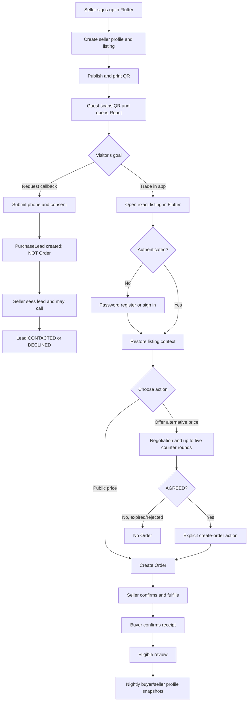
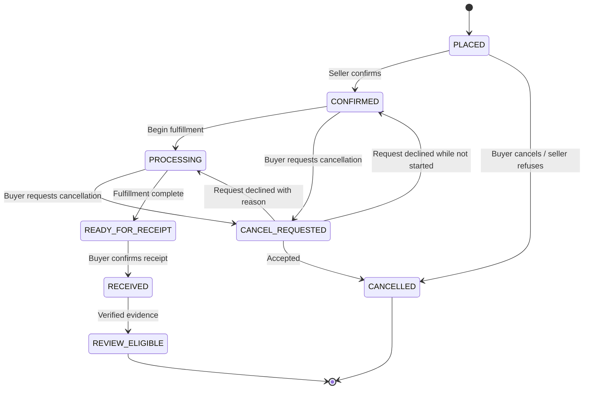
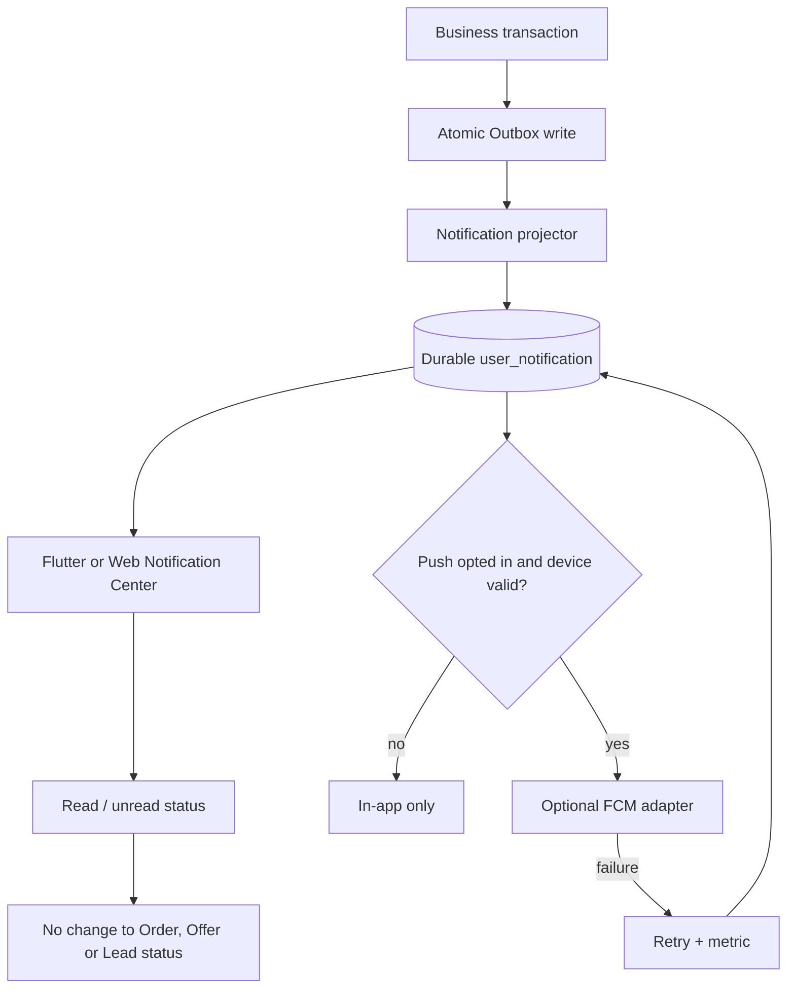

# QRM MVP — User Journeys, UML-like Schemes and Acceptance Matrix

**Status:** R0 Scenario Design — specification, not implemented.  
**Date:** 2026-11-12. Sources: [Requirements](REQUIREMENTS.md), [UX Flows](UX-FLOWS.md), [Domain Contracts](DOMAIN-CONTRACTS.md), [Auth/Notifications](AUTH-NOTIFICATIONS.md), [Nightly Aggregation](NIGHTLY-PROFILE-AGGREGATION.md).

## 1. Users, goals, channel boundaries

| Persona | Goal | Channel | Authentication |
|---|---|---|---|
| Visitor / guest | Open QR, compare price, request callback | React public Web | None |
| Buyer | Register, propose price, agree, order, confirm receipt, review | Flutter | Phone-as-login + password; phone **UNVERIFIED** |
| Seller | Register profile, publish listing, answer callback, negotiate, fulfill, view reputation | Flutter + React seller cabinet | Flutter password session; Web via QR approval from signed-in Flutter |
| Returning buyer | Favorite, price watch, repeat order, see activity level | Flutter | Existing session |
| Notification recipient | Read business notifications, optionally receive push | Flutter, seller Web | Authenticated |
| Scheduler/operator | Recalculate profile statistics | Backend | Internal service permissions only |

**Out of scope:** payments/escrow, independent seller financial solvency, SMS/OTP, Web guest Order, automatic paid loyalty rewards.

## 2. End-to-end map — one product QR, two legitimate entry paths



**Invariants:** guest Web callback must never auto-create Order; `AGREED` must not auto-create Order; explicit conversion idempotent; money settled directly, outside QRM.

## 3. Guest Web callback — sequence

```mermaid
sequenceDiagram
 actor V as Guest
 participant W as React Web
 participant API as QRM API
 participant DB as PostgreSQL
 participant O as Outbox
 participant S as Seller Inbox
 V->>W: Scan QR / view PUBLIC or UNLISTED listing
 W->>API: GET public listing and effective price
 API-->>W: Public view, no private contacts
 V->>W: Phone, quantity, desired price, callback consent
 W->>API: POST public/leads
 API->>API: Validate, rate-limit, anti-abuse, safe withdrawal capability
 API->>DB: Commit PurchaseLead
 API->>O: Commit LeadCreated in same transaction
 API-->>W: 202, opaque reference; no Order
 O-->>S: Project unread lead + durable notification
 S-->>V: Seller may call outside platform
```

**Follow-ups:** withdrawn lead becomes non-actionable, but no Order was ever created. No OTP or matching phone to account. Withdrawal requires an unguessable one-time capability, not assumed possession of phone.

## 4. Offer / agreement / Order — sequence

```mermaid
sequenceDiagram
 actor B as Flutter Buyer
 participant API as QRM API
 actor S as Flutter or Web Seller
 participant DB as PostgreSQL
 participant O as Outbox
 B->>API: Create negotiation with offered unit price
 API->>DB: Store session and offer
 API->>O: Outbox event
 API-->>S: New offer via Inbox / Notification Center
 loop up to 5 counter rounds
  S->>API: Counter offer or buyer counters
  API->>DB: Validate latest version, actor, expiry, rounds
  API-->>B: Latest offer
 end
 S->>API: Accept latest active offer
 API->>DB: Atomic transition to AGREED
 API-->>B: AGREED, no Order yet
 B->>API: Explicit create Order, Idempotency-Key
 API->>DB: Transaction: order snapshot + conversion unique constraint + Outbox
 API-->>B: Order ID; duplicate request returns same result
 O-->>S: New Order + internal notification
```

**Actors and round direction:** the actor accepting the latest offer must be the opposite party to the actor who made that offer. The decision of who can trigger `create-order` after AGREED must be resolved in final API/state machine and UI (proposed: buyer explicitly confirms). Definition of one counter round (one counter-offer vs complete exchange) remains an OPEN-01 decision.

## 5. Order, cancellation, receipt and review — state chart



**Note:** this is the **minimal physical-goods happy-path model**. It is a proposed normalized state chart, not the current final enum. Services/digital goods need type-specific fulfillment transitions. Legal claims and returns are separate aggregates, including after receipt. Non-response to receipt confirmation and dispute resolution need an explicit policy before implementation. Seller pressing `COMPLETED` is not payment evidence.

## 6. Login and Web seller QR approval

```mermaid
sequenceDiagram
 actor S as Seller
 participant F as Flutter
 participant W as React Seller Web
 participant API as QRM Identity
 participant DB as Session Store
 S->>F: Register phone login + nickname + password
 F->>API: POST auth/register
 API-->>F: Authenticated device session; phone unverified
 S->>W: Open /seller/login
 W->>API: Create short-lived browser-bound QR challenge
 API-->>W: QR code and browser secret cookie
 S->>F: Scan QR in authenticated Flutter
 F->>API: Get challenge origin/browser info
 S->>F: Explicit approve
 F->>API: Approve with existing authenticated session
 W->>API: Consume once with bound browser proof
 API->>DB: Create revocable HttpOnly Web session
 API-->>W: Seller cabinet access
```

**Failure paths:** expired/replayed QR, user rejection, different browser, stolen QR screenshot, compromised push token, Web session revoked. Push can notify existing device but must not itself approve login.

## 7. Notification lifecycle



**Privacy:** no phone, address or auth tokens in push payload. Reading a seller-inbox entry is not the same as reading a notification. Phone is a login identifier, not verified ownership.

## 8. Nightly buyer/seller reputation update

```mermaid
sequenceDiagram
 participant J as Nightly scheduler 02:30 Almaty
 participant PG as PostgreSQL
 participant A as Aggregator
 participant P as Profile API
 J->>PG: Acquire fenced lease, pin cutoff/watermark
 J->>A: Compute 9-month window
 A->>PG: Read qualified Order/Fulfillment and eligible reviews
 A->>PG: Stage buyer, seller, seller-buyer snapshots
 A->>PG: Reconcile totals and check lease fence
 alt Consistent snapshot
  A->>PG: Atomic publish active_run_id
  P->>PG: Read published profile
 else Failure
  A->>PG: Mark failed; keep previous active snapshot
  P->>PG: Read stale profile with timestamp
 end
```

**Buyer tier** and **seller trade tier** reflect qualified business activity, while **seller star rating** comes from eligible reviews. Anonymous leads and views do not upgrade tier. Seller sees only own history with buyer. Missing month activity does not reset tier.

## 9. Primary UI routes and visible outcome

| ID | Journey | UI entry | User sees | Backend state / side effect |
|---|---|---|---|---|
| UX-01 | Guest scans QR | React `/q/:token` → `/p/:id` | Listing, logo, images, tiers | view attribution only |
| UX-02 | Guest requests callback | React listing | Receipt/reference, no Order promise | Lead NEW, Inbox unread |
| UX-03 | Seller answers callback | React/Flutter Seller Inbox | Contacted / declined | Lead status, audit |
| UX-04 | Buyer signs up | Flutter registration | Account, phone unverified | User, credential, session |
| UX-05 | Buyer starts negotiation | Flutter listing | Offer history, expiry | Negotiation OPEN |
| UX-06 | Buyer/seller agrees | Flutter; Seller Web/Flutter | AGREED, create-order CTA | Negotiation AGREED, no Order |
| UX-07 | Buyer creates Order | Flutter | Confirmed price snapshot | Order PLACED, one-time conversion |
| UX-08 | Seller fulfills | Flutter/Seller Web | Fulfillment progress | guarded transitions |
| UX-09 | Buyer confirms receipt | Flutter order | Review CTA | receipt event + review eligibility |
| UX-10 | Buyer cancels | Flutter order | Cancellation or request status | guarded transition + audit |
| UX-11 | Buyer reviews seller/product | Flutter order | Star score + review receipt | eligible review, moderation |
| UX-12 | Seller sees reputation | React Seller page | Tier, rating and count, as-of | published seller snapshot |
| UX-13 | Seller sees regular customer | Seller Inbox/detail | Relationship in own store | authorized seller-buyer snapshot |
| UX-14 | User reads notification | Flutter/React seller | Unread decreases | notification read state only |
| UX-15 | Seller signs in on Web | React QR + Flutter | Revocable Web session | one-time challenge |
| UX-16 | Favorite and price watch | Flutter listing | saved, user-configured alert | watch record, optional push |

## 10. Negative / edge-case matrix (release blockers)

| ID | Situation | Required result |
|---|---|---|
| EDGE-01 | Listing archived between scan and form submit | no new Lead or Order; actionable message |
| EDGE-02 | Quantity tier / campaign changes before Order | server recomputes quote; never accept stale client total |
| EDGE-03 | Two simultaneous `create-order` actions | exactly one Order, deterministic idempotent response |
| EDGE-04 | User opens Flutter from QR without account | after login returns to exact listing |
| EDGE-05 | Contact number supplied in Web lead belongs to another user | no automatic account join or reputation disclosure |
| EDGE-06 | Seller owner reads another seller's lead | 403/404, no phone leak |
| EDGE-07 | Push provider unavailable | business action succeeds, notification persists |
| EDGE-08 | Receiver offline during read-state change | sync on reconnect; no lost business event |
| EDGE-09 | Buyer requests cancellation while seller processes | one legal deterministic outcome; audit |
| EDGE-10 | Full return after completion but before nightly job | next profile snapshot reflects approved correction |
| EDGE-11 | Buyer has zero completed orders | no false negative trust label |
| EDGE-12 | Seller has no eligible reviews | show no rating + count 0, not 0 stars |
| EDGE-13 | Password recovery without verified factor | no account takeover |
| EDGE-14 | QR login screenshot replay | reject, preserve browser-binding |
| EDGE-15 | Seller offer expires while buyer is agreeing | reject acceptance, explain expiry |
| EDGE-16 | Seller edits listing after Order | immutable Order price/listing snapshot |
| EDGE-17 | Service/digital tries physical-delivery transition | rejected, type-specific workflow required |
| EDGE-18 | Anonymous user tries to withdraw lead without capability | rejected; no account enumeration |
| EDGE-19 | Nightly worker fails after writing stage | previous published profile preserved |
| EDGE-20 | Multiple concurrent ratings for same order/subject | one eligible rating per rule; prevent inflation |

## 11. Acceptance checklist by stage

- **S0:** each UX/EDGE scenario has responsible actor, precondition, triggers, visible states, API contract, expected DB effect, audit, auth, retries and timeouts.
- **S1:** implement RED test cases at API/DB and React/Flutter E2E with fixed fixtures; no business logic implementation.
- **S2:** independent review confirms oracles, user-visible terminology and security boundaries; unresolved items block relevant feature merge.
- **S3:** implement minimum GREEN behavior in vertical slices.
- **S4:** end-to-end smoke with actual PostgreSQL, storage and simulated push outage; CI on exact commit.

## 12. Open questions to resolve before implementing the affected flow

1. **OPEN-01:** definition of a counter-offer round and who triggers `AGREED → Order` (this document proposes buyer explicit confirmation).
2. **OPEN-03:** KZT unit/total rounding policy and quote expiration.
3. **OPEN-04:** physical vs service vs digital fulfillment, proof of receipt and return.
4. **OPEN-05/10:** legal/privacy consent and personal-data retention in Kazakhstan.
5. **OPEN-11:** recovery without verified email or an already trusted logged-in device; phone is unverified.
6. **OPEN-12:** scope split v1.0 vs post-MVP for QR Web login/Push/favorites.
7. **OPEN-13 (new):** order receipt confirmation nonresponse and anti-self-dealing policy affecting nightly reputation.
8. **OPEN-14 (new):** consistency semantics for relation status after buyer account changes / seller staff access.

**Implementation note:** diagrams in this document are Markdown Mermaid and are not evidence of operational software.
